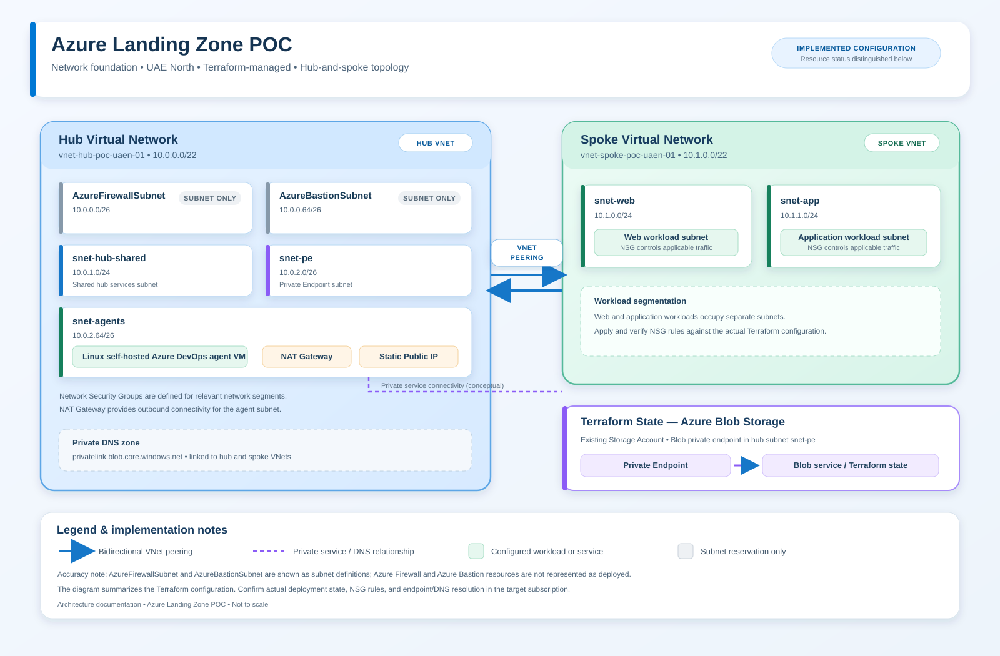
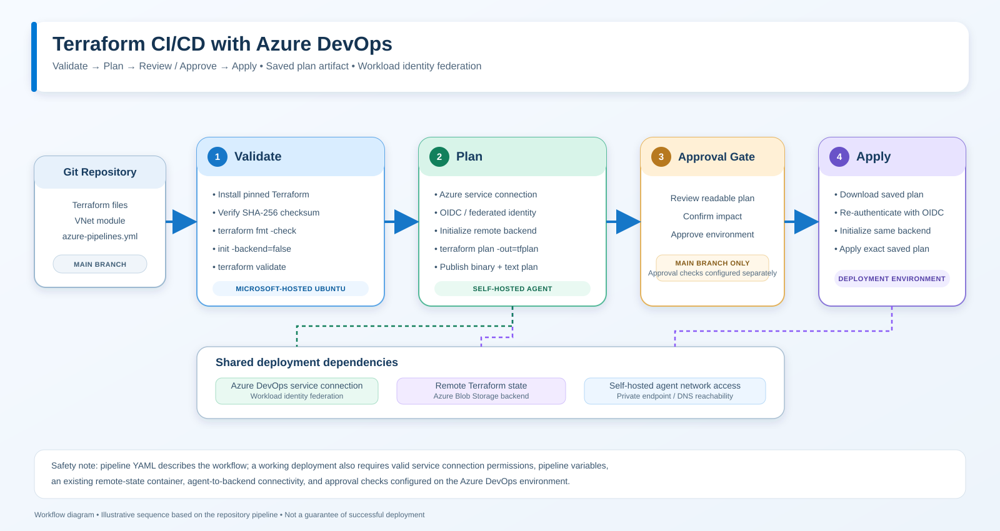

# ☁️ Azure Landing Zone POC

<p align="left">
  
  
    
  
  
</p>


A hands-on Azure Landing Zone proof of concept demonstrating secure network foundations, Terraform-based infrastructure management, controlled CI/CD workflows, and progressive security hardening.

The project follows an evidence-driven engineering approach: implement, validate, document, and review each stage before advancing to the next.

> **Project scope:** This is a phased proof of concept, not a claim that every capability of a production Azure Landing Zone has already been implemented. The roadmap distinguishes completed work from ongoing and planned activities.

---

# 📊 Project Dashboard

| Project Information        | Current Position                                          |
| -------------------------- | --------------------------------------------------------- |
| **Project**                | Azure Landing Zone POC                                    |
| **Cloud Platform**         | Microsoft Azure                                           |
| **Infrastructure as Code** | Terraform                                                 |
| **Azure Region**           | UAE North (`uaenorth`)                                    |
| **Completed Stage**        | 🟢 Stage 1 — Network Foundation & Terraform CI/CD         |
| **Current Focus**          | 🟢 Stage 2 — Self-hosted Agent & CI/CD Hardening                 |
| **Next Planned Stage**     | Stage 3 — Centralized Monitoring & Security Logging       |
| **Delivery Method**        | Incremental implementation with evidence-based acceptance |


---

# 🏗️ Landing Zone Architecture

The following diagram illustrates the Azure landing zone's hub-and-spoke network foundation.

<p align="center">
  
</p>

<details>
<summary>View the SVG version</summary>



</details>

---


# 🗺️ Project Roadmap

The project is organized into eight stages, progressing from foundational networking to security operations and operational handover.

##  Implementation Progress

|  Stage | Workstream                                       | Key Deliverables                                                                                                       |       Status       | Progress |
| :----: | ------------------------------------------------ | ---------------------------------------------------------------------------------------------------------------------- | :----------------: | :------: |
| **01** | 🌐 **Network Foundation & Terraform CI/CD**      | Hub-and-spoke VNets, subnet segmentation, NSGs, VNet peering, Terraform validation, remote state, drift reconciliation |  🟢 **Completed**  |  `█████` |
| **02** | 🔐 **Self-hosted Agent & CI/CD Hardening**       | Agent runtime security, non-root execution, SSH security assessment, permissions review, pipeline artifact protection  | 🟢 **Completed** | `█████` |
| **03** | 📊 **Centralized Monitoring & Security Logging** | Log Analytics, diagnostic settings, log ingestion, alert rules, notification validation                                |  ⚪ **Not Started** |  `░░░░░` |
| **04** | 🪪 **Identity & Privileged Access**              | Workload identity federation, access-scope review, least-privilege role assignments, privileged-access controls        |  ⚪ **Not Started** |  `░░░░░` |
| **05** | 🛡️ **Azure Firewall & Centralized Egress**      | Firewall architecture, routing, controlled outbound connectivity, traffic-flow validation                              |  ⚪ **Not Started** |  `░░░░░` |
| **06** | 📋 **Governance & Policy Enforcement**           | Azure Policy initiatives, assignments, resource governance, compliance evaluation                                      |  ⚪ **Not Started** |  `░░░░░` |
| **07** | ♻️ **Backup, Recovery & Resilience**             | Backup scope, retention requirements, recovery testing, resilience evidence                                            |  ⚪ **Not Started** |  `░░░░░` |
| **08** | ✅ **Security Validation & Operational Handover** | End-to-end validation, runbooks, outstanding-risk register, operational documentation, handover checklist              |  ⚪ **Not Started** |  `░░░░░` |

> **Progress-bar note:** The bars are visual planning indicators, not measured completion percentages. Stage 1 is marked complete based on the completed network-foundation work. Stage 2 assessment and CI/CD approval validation have been completed. Remaining hardening actions are tracked as follow-up improvements.

## 📍 Current Priorities

### 🟢 Stage 1 — Network Foundation & Terraform CI/CD

**Status: Completed**

The network-foundation stage established the reusable Terraform-managed Azure hub-and-spoke architecture, network segmentation, NSG policies, VNet peering, remote state, and drift-reconciliation workflow.

### 🟢 Stage 2 — Self-hosted Agent & CI/CD Hardening

**Status: Completed — assessment and validation**

The Stage 2 assessment reviewed the self-hosted Azure DevOps agent and associated CI/CD workflows, including security controls and deployment approval behavior.

Outstanding verification includes:

* Confirming the agent's runtime identity and non-root execution.
* Reviewing the current SSH service state and authentication configuration.
* Reviewing agent version and update considerations.
* Verifying the agent's permissions and relevant Azure role assignments.
* Reviewing pipeline artifact handling and sensitive-file exposure.
* Recording the results against the relevant acceptance criteria.

A disposable VM was used to validate SSH authentication hardening. That test does not, by itself, prove that the existing agent VM has been hardened or that every Stage 2 requirement is satisfied.

### ⚪ Stage 3 — Centralized Monitoring & Security Logging

**Planned scope**

* Establish the monitoring and diagnostic-settings strategy.
* Configure appropriate Log Analytics ingestion.
* Validate that expected resource logs arrive.
* Implement relevant alerts and test notification delivery.
* Document monitoring coverage and known gaps.

### ⚪ Stage 4 — Identity & Privileged Access

**Planned scope**

* Review workload identity federation.
* Validate service-connection authentication and access scope.
* Review role assignments against least-privilege requirements.
* Document privileged access and identity-related security controls.

### ⚪ Stages 5–8 — Platform Security and Operational Readiness

These stages will extend the foundation with centralized egress, governance, resilience, and operational acceptance.

Each stage will be assessed against its own scope and acceptance evidence before its status is changed to completed.

---

# 🏗️ Architecture

The network design uses a hub-and-spoke model to separate shared network infrastructure from workload subnet boundaries.

The hub contains the network foundation and reserved subnet locations for potential future shared services. The spoke separates web and application tiers.

**Traffic-flow consideration:** VNet peering provides private connectivity between VNets. It does not automatically route all traffic through Azure Firewall. Centralized inspection requires a deployed firewall or supported network appliance, appropriate routing, and policy configuration.

## Network Address Plan

### Hub Virtual Network

| Component              | CIDR           | Purpose                                            |
| ---------------------- | -------------- | -------------------------------------------------- |
| `vnet-hub-poc-uaen-01` | `10.0.0.0/22`  | Hub network                                        |
| `AzureFirewallSubnet`  | `10.0.0.0/26`  | Reserved for a potential Azure Firewall deployment |
| `AzureBastionSubnet`   | `10.0.0.64/26` | Reserved for a potential Azure Bastion deployment  |
| `snet-hub-shared`      | `10.0.1.0/24`  | Shared-services subnet boundary                    |

### Spoke Virtual Network

| Component                | CIDR          | Purpose                 |
| ------------------------ | ------------- | ----------------------- |
| `vnet-spoke-poc-uaen-01` | `10.1.0.0/22` | Workload spoke          |
| `snet-web`               | `10.1.0.0/24` | Web tier subnet         |
| `snet-app`               | `10.1.1.0/24` | Application tier subnet |

**Azure region:** UAE North (`uaenorth`)

## Network Security Policy

Separate NSGs are associated with the web and application subnets.

| NSG                   | Priority | Rule                        | Behavior                                                      |
| --------------------- | -------: | --------------------------- | ------------------------------------------------------------- |
| `nsg-web-poc-uaen-01` |     4000 | `Deny-All-Inbound`          | Explicitly denies inbound traffic                             |
| `nsg-app-poc-uaen-01` |      100 | `Allow-Web-To-App-TCP-8080` | Allows TCP 8080 from the web subnet to the application subnet |
| `nsg-app-poc-uaen-01` |     4000 | `Deny-All-Inbound`          | Explicitly denies other inbound traffic                       |

The application allow rule is evaluated before the explicit deny rule because it has a lower numerical priority.

These NSGs define policy boundaries. The original network-foundation POC did not include application VMs, so the TCP 8080 rule was not tested against a live endpoint as part of that implementation.

## VNet Peering

Both peerings were verified as connected:

* `peer-hub-to-spoke`
* `peer-spoke-to-hub`

Forwarded traffic is enabled on both peerings. Gateway transit is enabled on the hub-to-spoke peering only. Remote gateway use is disabled.

No virtual network gateway deployment is included in the current network-foundation scope.

---

# 🧱 Infrastructure as Code

Terraform is used to define and manage the network foundation and its supporting resources.

## Original Network-Foundation Structure

```text
pe-01-landing-zone/
├── bootstrap/
│   ├── main.tf
│   ├── providers.tf
│   ├── variables.tf
│   ├── versions.tf
│   ├── terraform.tfvars
│   └── .terraform.lock.hcl
├── modules/
│   └── vnet/
│       ├── main.tf
│       ├── variables.tf
│       └── outputs.tf
├── .gitignore
├── .terraform.lock.hcl
├── locals.tf
├── main.tf
├── nsg.tf
├── outputs.tf
├── providers.tf
├── terraform.tfvars
├── variables.tf
└── versions.tf
```

This tree represents the original network-foundation structure, not an exhaustive listing of every subsequent project artifact.

## Key Design Decisions

* A reusable VNet module is called for both hub and spoke networks.
* The bootstrap configuration provisions the storage resources required by the root backend and retains separate local state.
* Root configuration manages the network resource group, VNets, peerings, NSGs, and subnet associations.
* Common tags are defined centrally and applied to taggable resources.
* Provider versions are constrained.
* Provider lock files are version-controlled to support repeatable initialization.

---

# 🔒 Remote State & Security Controls

The root Terraform state is stored in an Azure Storage container.

The implemented configuration includes:

* Microsoft Entra ID authorization for Storage data-plane operations.
* Shared-key authorization disabled.
* Anonymous blob access disabled and private container access.
* HTTPS-only transport with TLS 1.2 minimum.
* Blob versioning enabled.
* Standard locally redundant storage (LRS) for the POC.

The bootstrap configuration is intentionally separate from the root network configuration to avoid a circular dependency during backend initialization.

**State security:** Terraform state and saved plan files can contain sensitive infrastructure information. They must not be committed to source control or published as ordinary artifacts.

---

# ⚙️ Deployment Workflow
The following diagram illustrates the Terraform infrastructure deployment workflow.

<p align="center">
  
</p>

<details>
<summary>View the SVG version</summary>



</details>

---

## Prerequisites

* An Azure subscription with appropriate resource permissions.
* Azure CLI authenticated to the intended tenant and subscription.
* A compatible Terraform version.
* Microsoft Entra ID permissions for Azure resource management and Storage data-plane access.
* Git.

## 1. Authenticate and Verify the Subscription

```powershell
az login

az account show
```

Confirm that the active subscription is the intended target before proceeding.

## 2. Initialize and Review the Bootstrap Configuration

The bootstrap stack provisions the state resource group, storage account, and private container.

```powershell
Set-Location .\bootstrap

terraform init

terraform validate

terraform plan
```

Review the plan before applying.

If these resources already exist, reconcile the existing state and configuration rather than attempting to recreate them.

## 3. Initialize and Review the Root Configuration

Return to the project root:

```powershell
Set-Location ..

terraform init

terraform validate

terraform plan
```

The root backend must reference the provisioned storage account and container.

Review backend settings and authorization before initialization.

## 4. Apply a Reviewed Plan

```powershell
terraform plan -out="pe01-reviewed.tfplan"

terraform show "pe01-reviewed.tfplan"

terraform apply "pe01-reviewed.tfplan"
```

Apply only after reviewing the proposed changes and confirming the target subscription.

A saved plan should be treated as sensitive because it may contain infrastructure details and other sensitive values.

## 5. Validate the Resulting Configuration

```powershell
terraform fmt -check -recursive

terraform validate

terraform plan

terraform output
```

When deployed resources match the declared configuration, Terraform should report:

```text
No changes. Your infrastructure matches the configuration.
```

---

# 🧪 Verification & Drift Reconciliation

The network-foundation implementation was checked using Terraform formatting and validation commands. The final plan reported no changes.

A controlled drift exercise was also completed:

1. A tag was added manually to the application NSG in Azure.
2. Terraform detected the undeclared tag during planning.
3. The reviewed saved plan proposed removing the tag to restore the declared configuration.
4. The plan was applied.
5. The tag was verified as absent.
6. A subsequent plan reported no changes.

This exercise demonstrates configuration reconciliation for a controlled resource-tag change.

---

# 🏷️ Governance Tags

| Tag           | Example Value        |
| ------------- | -------------------- |
| `owner`       | `cloud-platform-poc` |
| `environment` | `poc`                |
| `costcenter`  | `CC100`              |
| `workload`    | `landingzone`        |
| `managed-by`  | `terraform`          |

---

# 📂 Security Evidence & Documentation

Evidence should support implementation claims and the acceptance status of each stage.

| Evidence Area                                          | Purpose                                                                 |
| ------------------------------------------------------ | ----------------------------------------------------------------------- |
| `cloud-init/`                                          | Initial VM configuration and hardening                                  |
| `tests/`                                               | Repeatable infrastructure and security validation                       |
| `reports/evidence/AC-08/`                              | Agent security and runtime evidence                                     |
| `reports/evidence/AC-09/`                              | Secret-scanning evidence                                                |
| `reports/evidence/AC-11-role-assignment-baseline.json` | Role-assignment baseline; review and sanitize before public publication |

The PE-02 disposable SSH-hardening validation includes a Terraform test configuration, cloud-init configuration, and a validation report documenting the test results and cleanup.

**Evidence boundary:** A successful test on a disposable VM demonstrates the behavior of that test environment. It does not automatically establish that the existing self-hosted agent meets the same requirements.

Before publishing evidence publicly, review screenshots and reports for:

* Credentials, tokens, or private keys.
* Sensitive subscription or tenant details.
* Unnecessary principal identifiers or internal resource details.
* Local filesystem paths that you do not want to disclose.
* Terraform state or saved plan contents.


---

# 💰 Operational & Cost Considerations

The POC creates network resources and a remote-state storage backend. Azure charges may apply while resources remain deployed.

Review Azure Cost Management before leaving resources running.

For teardown:

1. Capture required evidence.
2. Review the destroy plan carefully.
3. Confirm the resources selected for deletion.
4. Preserve the bootstrap resource group, storage account, private container, and root remote state if subsequent stages depend on them.

**Do not remove the backend while the root Terraform state still depends on it.**

Existing shared infrastructure must not be modified or destroyed merely to clean up a disposable test.

---

# 📌 Scope Boundaries

* The network-foundation POC does not include deployed Azure Firewall or Azure Bastion services; only their subnets are reserved.
* No virtual network gateway is deployed.
* The original network-foundation implementation does not include application VMs or application endpoints.
* TCP 8080 is defined in the application NSG policy but was not validated against a live endpoint in the original network-foundation POC.
* The PE-02 SSH-hardening test validates a disposable VM and does not, by itself, prove persistent hardening of the existing Azure DevOps agent.
* The roadmap represents phased target work; a planned capability must not be represented as completed without implementation and supporting evidence.

---

# 🏁 Project Outcome

The completed Stage 1 network foundation demonstrates a repeatable Azure network architecture using Terraform, with subnet segmentation, explicit NSG policy, bidirectional VNet peering, secure remote-state configuration, consistent tagging, and a controlled drift-reconciliation workflow.

Stage 2 assessment and CI/CD approval validation have been completed. Remaining hardening actions are tracked as follow-up improvements. Subsequent stages will extend the foundation with centralized monitoring, identity and privileged-access controls, centralized egress, governance, resilience, and operational handover.

This POC is a foundation for further evaluation, not a complete production landing zone. Production adoption would require additional workload testing, identity and access review, routing and inspection design, monitoring, policy enforcement, DNS strategy, resilience testing, and formal operational acceptance.
