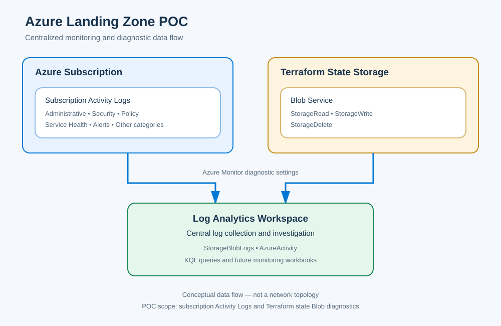

# Centralized Monitoring Module

## Overview

The Monitoring module provides a centralized monitoring foundation for the Azure Landing Zone POC. It uses Terraform to manage Azure Monitor diagnostic settings and a Log Analytics workspace for collecting platform logs.

The objective is to improve operational visibility, support security investigations, and establish a foundation for future alerting and monitoring automation.

## Architecture

The module manages the following components:

* **Log Analytics workspace** — central destination for supported diagnostic logs.
* **Subscription Activity Log diagnostics** — exports selected subscription-level activity categories.
* **Storage Blob diagnostics** — collects read, write, and delete operations from the Terraform state storage account's Blob service.

### Monitoring data flow



*Conceptual diagram: diagnostic data flows from Azure resources to the centralized workspace. It does not represent network connectivity.*

## Terraform implementation

The module is located in:

`modules/monitoring/`

Key files:

| File                     | Purpose                                                                    |
| ------------------------ | -------------------------------------------------------------------------- |
| `main.tf`                | Defines the monitoring resource group, workspace, and diagnostic settings. |
| `variables.tf`           | Defines configurable module inputs and validation.                         |
| `outputs.tf`, if present | Exposes selected module outputs.                                           |

The root configuration calls this module from `monitoring.tf`.

The module accepts configurable resource names, location, tags, retention settings, subscription scope, and the Terraform state Blob service resource ID.

## Logging coverage

### Subscription Activity Logs

The configuration enables these categories:

* Administrative
* Security
* ServiceHealth
* Alert
* Recommendation
* Policy
* Autoscale
* ResourceHealth

### Terraform state Blob operations

The Blob service diagnostic setting enables:

* `StorageRead`
* `StorageWrite`
* `StorageDelete`

These categories help investigate storage access patterns and operations against the Terraform backend.

## Validation and verification

The implementation was validated using Terraform with backend initialization disabled for configuration validation.

The Azure DevOps pipeline subsequently completed successfully, including the Terraform Plan and approval-gated deployment stages.

The Blob diagnostic setting was also verified through Azure CLI, and events were observed in the `StorageBlobLogs` table in Log Analytics.

Example query:

```kusto
StorageBlobLogs
| where TimeGenerated > ago(24h)
| where AccountName == "<storage-account-name>"
| summarize EventCount = count()
    by Category, OperationName
| order by Category asc, EventCount desc
```

Replace the placeholder with the storage account name in your own environment.

## Security considerations

* The Terraform state storage account remains private.
* Diagnostic configuration does not require enabling public network access.
* The public portfolio must not contain subscription IDs, tenant IDs, credentials, Terraform state files, saved plans, or unredacted diagnostic output.
* Log collection is not a replacement for access control, alerting, or incident response procedures.

## Future improvements

* Extend diagnostic coverage to selected network and compute resources.
* Introduce actionable alerts and notification groups.
* Develop monitoring workbooks.
* Review workspace access controls, retention, and ingestion costs.
* Document operational investigation procedures.

## Scope note

This module documents the monitoring capabilities implemented in the POC. It does not imply that every Azure resource has diagnostic settings configured or that all security monitoring requirements have been satisfied.
