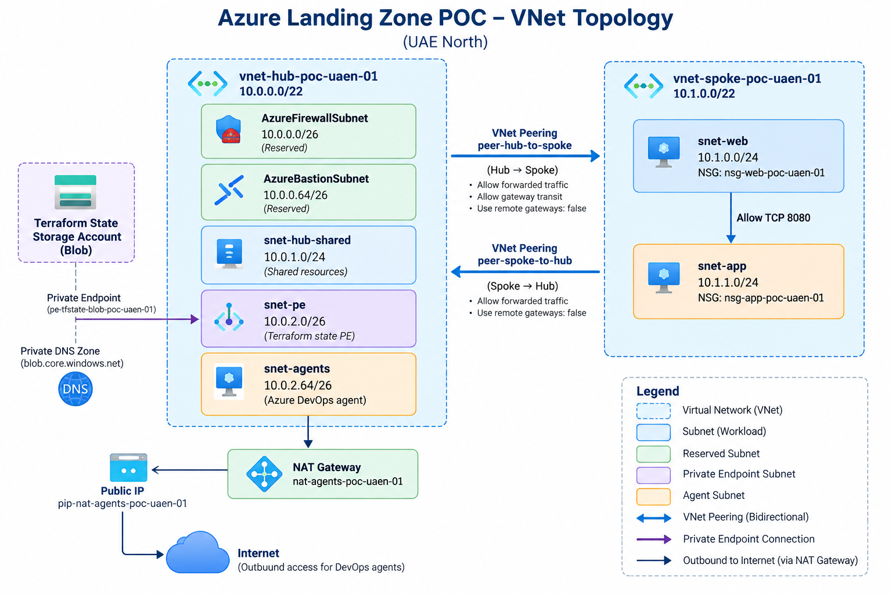

# Azure Virtual Network Module

Reusable Terraform module for creating Azure Virtual Networks (VNets) and subnets with validated inputs and organizational tagging.

This module is part of the **Azure Landing Zone POC**.

## Architecture
The following diagram illustrates the hub-and-spoke network architecture implemented in this POC, including VNet peering, subnet address ranges, private endpoint connectivity, and outbound connectivity for the Azure DevOps agent.


*Figure 1. Overall Azure Landing Zone POC architecture.*

## 1. Module Responsibilities

The module creates:

* One Azure Virtual Network.
* Multiple subnets using Terraform `for_each`.
* Configurable address spaces and subnet prefixes.
* Optional subnet-level default outbound access configuration.
* Required organizational tags on the VNet.

It exports VNet attributes and subnet IDs for use by other Terraform resources.

**Managed separately:** VNet peering, Network Security Groups (NSGs), NAT Gateways, private endpoints, private DNS zones, routing, and workloads.

## 2. Module Structure

| File           | Purpose                                 |
| -------------- | --------------------------------------- |
| `main.tf`      | Defines the VNet and subnet resources.  |
| `variables.tf` | Defines inputs and validation rules.    |
| `outputs.tf`   | Exposes VNet attributes and subnet IDs. |
| `README.md`    | Documents module usage and behavior.    |

## 3. Input Variables

| Variable              | Type           | Description                                                            |
| --------------------- | -------------- | ---------------------------------------------------------------------- |
| `vnet_name`           | `string`       | Name of the VNet; validated to be 2–64 characters long.                |
| `resource_group_name` | `string`       | Existing resource group for the VNet.                                  |
| `location`            | `string`       | Azure deployment region.                                               |
| `address_space`       | `list(string)` | VNet CIDR address ranges; at least one is required.                    |
| `subnets`             | Map of objects | Defines subnet address prefixes and optional outbound access settings. |
| `tags`                | `map(string)`  | Organizational tags required by the module.                            |

### Subnet Properties

| Property                          | Type            | Description                                                            |
| --------------------------------- | --------------- | ---------------------------------------------------------------------- |
| `address_prefixes`                | `list(string)`  | CIDR ranges assigned to the subnet; at least one is required.          |
| `default_outbound_access_enabled` | Optional `bool` | Controls the subnet's default outbound access setting when configured. |

### Required Tags

The module requires these five tag keys:

* `owner`
* `environment`
* `costcenter`
* `workload`
* `managed-by`

These tags are applied to the VNet. The module does not directly apply them to subnet resources.

## 4. Outputs

| Output          | Description                                      |
| --------------- | ------------------------------------------------ |
| `vnet_id`       | Azure resource ID of the VNet.                   |
| `vnet_name`     | VNet name.                                       |
| `address_space` | Configured VNet address ranges.                  |
| `subnet_ids`    | Map of subnet names to their Azure resource IDs. |

Other resources can use `subnet_ids` to associate NSGs, private endpoints, or other supported network resources with specific subnets.

## 5. Current POC Configuration

The root Terraform configuration uses this module to create two VNets.

### Hub VNet

**Name:** `vnet-hub-poc-uaen-01`
**Address space:** `10.0.0.0/22`

| Subnet                | Address Prefix | Purpose                                          |
| --------------------- | -------------- | ------------------------------------------------ |
| `AzureFirewallSubnet` | `10.0.0.0/26`  | Reserved for a future Azure Firewall deployment. |
| `AzureBastionSubnet`  | `10.0.0.64/26` | Reserved for a future Azure Bastion deployment.  |
| `snet-hub-shared`     | `10.0.1.0/24`  | Shared hub services.                             |
| `snet-pe`             | `10.0.2.0/26`  | Terraform state private endpoint.                |
| `snet-agents`         | `10.0.2.64/26` | Self-hosted Azure DevOps agent.                  |

### Spoke VNet

**Name:** `vnet-spoke-poc-uaen-01`
**Address space:** `10.1.0.0/22`

| Subnet     | Address Prefix | Purpose               |
| ---------- | -------------- | --------------------- |
| `snet-web` | `10.1.0.0/24`  | Web workload.         |
| `snet-app` | `10.1.1.0/24`  | Application workload. |

The VNets have bidirectional peering configured through `peer-hub-to-spoke` and `peer-spoke-to-hub`.

**Note:** Reserved subnet names do not mean the corresponding Azure Firewall or Bastion resources have been deployed.

## 6. Example Module Usage

The following example illustrates the module interface. Values are examples, not additional resources in the current POC.

```hcl
module "example_vnet" {
  source = "./modules/vnet"

  vnet_name           = "vnet-example-poc-uaen-01"
  resource_group_name = "rg-network-example-poc-uaen-01"
  location            = "uaenorth"

  address_space = ["10.20.0.0/16"]

  subnets = {
    snet-web = {
      address_prefixes = ["10.20.1.0/24"]
    }

    snet-app = {
      address_prefixes                = ["10.20.2.0/24"]
      default_outbound_access_enabled = false
    }
  }

  tags = {
    owner       = "platform-team"
    environment = "poc"
    costcenter  = "example"
    workload    = "landing-zone"
    managed-by  = "terraform"
  }
}
```

### How It Works

1. Terraform loads the reusable module.
2. The module creates the VNet using the supplied inputs.
3. Terraform iterates over the subnet map using `for_each`.
4. Each map key becomes a subnet name.
5. The module exports VNet attributes and subnet IDs.

Review the Terraform plan before applying changes to existing infrastructure.

## 7. Implementation Details

### Dynamic Subnet Creation

The subnet resource uses:

```hcl
for_each = var.subnets
```

This allows the root configuration to define different subnet layouts without duplicating the subnet resource block.

### Optional Outbound Access

The module uses:

```hcl
default_outbound_access_enabled = try(
  each.value.default_outbound_access_enabled,
  null
)
```

When the setting is omitted, the module passes `null` to the provider. The effective behavior depends on the AzureRM provider and Azure platform behavior applicable to the resource.

For security-sensitive subnets, explicitly assess outbound connectivity requirements.

### Validation

The module validates:

* VNet name length.
* Presence of at least one VNet address range.
* Presence of at least one address prefix per subnet.
* Presence of all five required organizational tag keys.

These validations do not replace comprehensive CIDR overlap checks or a full security assessment.

## 8. Security Considerations

| Area                 | Consideration                                                    |
| -------------------- | ---------------------------------------------------------------- |
| Address planning     | Avoid unintended overlap with connected networks.                |
| Segmentation         | Separate workloads according to security requirements.           |
| NSGs                 | Apply appropriate inbound and outbound traffic controls.         |
| Routing              | Review route tables and effective routes.                        |
| Outbound access      | Explicitly design and monitor egress connectivity.               |
| Private connectivity | Configure private endpoints and private DNS where required.      |
| Peering              | Review address spaces, traffic forwarding, and gateway settings. |
| Governance           | Enforce organizational policies and tagging requirements.        |
| Monitoring           | Configure appropriate diagnostics and monitoring.                |

Creating a VNet and its subnets does not automatically implement these additional controls.

## 9. Validation

Run validation from the appropriate Terraform working directory:

```powershell
terraform fmt -check -recursive
terraform init -backend=false -input=false
terraform validate
```

`terraform init -backend=false` is suitable for configuration validation that does not require access to the remote state backend.

For this POC, state-dependent plan and apply operations must use the designated Azure DevOps self-hosted agent because the Terraform state storage is privately networked.

**Do not bypass the private backend's network controls to run local plan or apply operations.**

### Pre-Deployment Checklist

* [ ] Verify VNet names, region, and resource group.
* [ ] Review VNet and subnet CIDR ranges.
* [ ] Check for address-space overlap.
* [ ] Confirm required organizational tags.
* [ ] Review outbound connectivity requirements.
* [ ] Review related NSGs, routing, and private connectivity.
* [ ] Run formatting and validation checks.
* [ ] Review the Terraform plan before applying changes.

## 10. Design Principles

This module supports:

* **Reusability:** One module supports different VNet and subnet layouts.
* **Consistency:** Standardized inputs and organizational tags.
* **Separation of concerns:** Network creation is separate from security, routing, and monitoring.
* **Composability:** Outputs allow other Terraform resources to reference the network.
* **Controlled deployment:** Infrastructure changes follow the approved deployment workflow.

## Summary

The VNet module provides a reusable Terraform foundation for the Azure Landing Zone POC. It creates VNets and subnets, validates selected inputs, applies organizational tags to VNets, and exports resource IDs for integration with other infrastructure components.

Peering, NSGs, private endpoints, routing, governance, and monitoring are managed separately as part of the overall landing zone.
