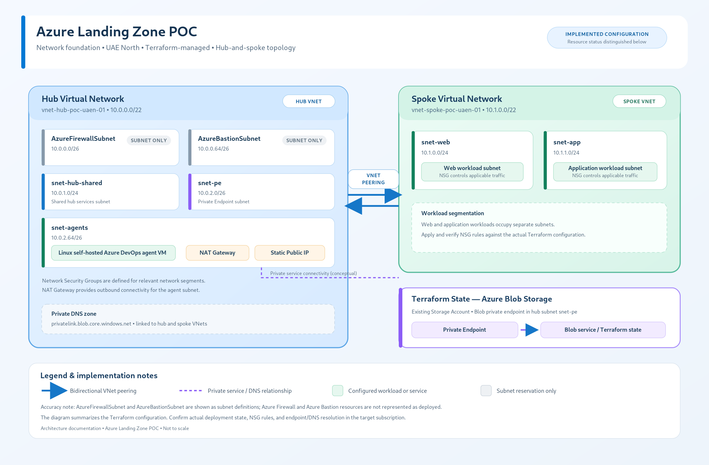
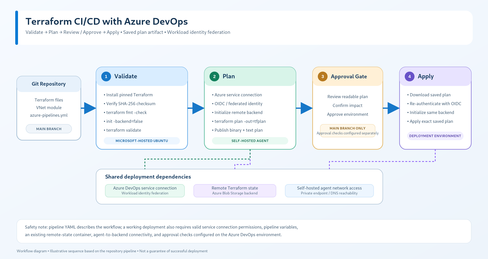

# Azure Landing Zone POC — Architecture and Security Assessment

**Document type:** Engineering case study
**Status:** Working report — update as acceptance evidence is finalized
**Scope:** Azure hub-and-spoke networking, private Terraform state access, Terraform infrastructure as code, and Azure DevOps CI/CD

## 1. Executive Summary

This proof of concept demonstrates an Azure landing-zone-style network foundation managed with Terraform and delivered through an Azure DevOps pipeline. The design separates shared hub services from workload subnets in a spoke, uses network security groups to constrain traffic, and accesses Terraform state through an Azure Storage Blob Private Endpoint.

The project also uses an Azure DevOps service connection configured with Workload Identity Federation (WIF), plus a self-hosted agent VM in a private subnet for Terraform Plan and Apply.

Evidence collected so far indicates that the Private Endpoint is approved, the self-hosted agent resolves the Blob endpoint to private IP `10.0.2.4`, and the pipeline completed successfully after public network access on the state account was disabled. Several acceptance items still require stronger or more durable evidence; those are identified below rather than treated as complete.

## 2. Scope and Objectives

The POC is intended to demonstrate:

- Repeatable infrastructure deployment using Terraform.
- Hub-and-spoke network segmentation.
- Private access to the Terraform state storage account.
- Controlled CI/CD with separate validation, plan, approval, and apply stages.
- A private self-hosted agent with no public IP.
- Federated authentication rather than a long-lived client secret.
- Evidence-based acceptance testing and documented follow-up work.

This is a proof of concept. It is not, by itself, a claim of production readiness, regulatory compliance, or complete security certification.

## 3. Architecture Overview



The current design contains the following components:

| Component | Name / configuration | Purpose |
|---|---|---|
| Region | UAE North (`uaenorth`) | Deployment region |
| Hub VNet | `vnet-hub-poc-uaen-01`, `10.0.0.0/22` | Shared network services and agent subnet |
| Spoke VNet | `vnet-spoke-poc-uaen-01`, `10.1.0.0/22` | Workload network |
| Agent subnet | `snet-agents`, `10.0.2.64/26` | Hosts private self-hosted agent |
| Agent VM | `vm-agent-poc-uaen-01`, private IP `10.0.2.68` | Runs Terraform Plan/Apply jobs |
| Agent NSG | `nsg-agents-poc-uaen-01` | Restricts inbound and outbound network flows |
| Agent outbound NAT | `nat-agents-poc-uaen-01` and `pip-nat-agents-poc-uaen-01` | Provides outbound translation for the agent subnet; the VM has no directly assigned public IP |
| State account | `sttfstatepocuaen7261` | Terraform remote state storage |
| Private Endpoint | `pe-tfstate-blob-poc-uaen-01` | Private connection to Blob service |
| Private DNS zone | `privatelink.blob.core.windows.net` | Resolves Blob endpoint to private IP |
| Azure DevOps service connection | `sc-azure-poc-wif` | Federated Azure authentication |
| Agent pool | `pool-poc-vnet` | Runs Plan/Apply jobs on private agent |

Resource names are included to make the report traceable to the POC. Before publishing, review whether you want these identifiers public; redact any that you consider sensitive.

## 4. Network Segmentation

### Hub network

The hub VNet uses address space `10.0.0.0/22` and includes:

- `AzureFirewallSubnet` — `10.0.0.0/26`
- `AzureBastionSubnet` — `10.0.0.64/26`
- `snet-hub-shared` — `10.0.1.0/24`
- `snet-pe` — `10.0.2.0/26`
- `snet-agents` — `10.0.2.64/26`

### Spoke network

The spoke VNet uses `10.1.0.0/22` and includes:

- `snet-web` — `10.1.0.0/24`
- `snet-app` — `10.1.1.0/24`

Hub-spoke peering connects the network layers. NSGs are applied to workload and agent subnets. The agent VM has no directly assigned public IP address; its subnet is associated with a NAT Gateway and Standard static public IP for outbound internet connectivity. The agent NSG evidence showed a `Deny-All-Inbound` rule at priority 4000 and an outbound HTTPS rule allowing TCP 443 to `Any` at priority 100.

**Security note:** NAT provides address translation, not destination filtering. The broad outbound HTTPS rule is a known hardening opportunity. Required Azure DevOps, Azure Resource Manager, Storage, package-feed, and agent dependencies should be inventoried before restricting egress.

## 5. Terraform State and Private Connectivity

The Terraform backend uses an Azure Storage account and Blob container. The backend example file uses placeholders and Azure AD authentication:

```hcl
resource_group_name  = "REPLACE_WITH_STATE_RESOURCE_GROUP"
storage_account_name = "REPLACE_WITH_STATE_STORAGE_ACCOUNT"
container_name       = "tfstate"
key                  = "landingzone.tfstate"
use_azuread_auth     = true
```

The state account's public network access was set to Disabled. The Private Endpoint `pe-tfstate-blob-poc-uaen-01` was reported as Succeeded and Approved for the Blob subresource.

From the agent VM, DNS resolution returned the private IP `10.0.2.4` through the `privatelink.blob.core.windows.net` namespace. A TCP 443 connectivity test from the agent succeeded. A pipeline run after public access was disabled also completed successfully.

### Evidence limitation

From the laptop, the Blob hostname continued to resolve to a public IP and TCP 443 was reachable. An unauthenticated request returned HTTP 403 `AuthorizationFailure`; that response alone does not prove the storage network policy caused the failure. Therefore, the report does not claim that laptop network denial has been conclusively demonstrated. A new authenticated request with its exact error, compared with successful agent-side access, is required for stronger closure evidence.

## 6. Identity and Access

The Azure DevOps service connection `sc-azure-poc-wif` was observed using Workload Identity Federation. The associated app registration showed zero client secrets, zero certificates, and one federated credential.

The recorded role assignments for the pipeline identity included:

- Contributor on `rg-network-poc-uaen-01`.
- Storage Blob Data Contributor on the state storage account `sttfstatepocuaen7261`.

These assignments should be reviewed against the minimum permissions needed for the actual pipeline operations. A before-change baseline was not captured, so the claim that role assignments remained unchanged cannot yet be independently demonstrated.

## 7. CI/CD Workflow



The intended workflow has these stages:

1. **Validate** — Terraform formatting/validation on a hosted Ubuntu agent.
2. **Plan** — Terraform backend initialization and plan on the self-hosted pool.
3. **Approval** — Manual/environment approval gate.
4. **Apply** — Apply the saved plan from the pipeline artifact on the self-hosted pool.

A run after the state account's public network access was disabled completed with Validate, Plan, approval, and Apply green. Plan and Apply used the `pool-poc-vnet` pool and `vm-agent-poc-uaen-01`.

The GitHub portfolio copy pins the Validate image to `ubuntu-24.04` in commit `53b53ec`. This change was made in the portfolio repository only; it did not update the live Azure Repos pipeline. The portfolio YAML includes placeholders and must not be copied into the live pipeline without replacing and reviewing those values.

## 8. Agent Security Posture

The agent VM was observed with private IP `10.0.2.68` and no public IP. The effective security-rule view showed inbound deny behavior. The live VM's effective SSH configuration was changed and validated with `sshd -t`; `sshd -T` reported:

- `permitrootlogin no`
- `pubkeyauthentication yes`
- `passwordauthentication no`
- `kbdinteractiveauthentication no`

The SSH service was inactive/disabled at the time of observation.

**Persistence gap:** These settings were applied to the live VM, but persistence through Terraform or cloud-init has not yet been confirmed. The full service account name and UID for the Azure DevOps agent also need to be captured to close the non-root service-account criterion.

## 9. Secret and Configuration Hygiene

A preliminary PowerShell scan of working files, excluding `.git` and `.terraform`, found no matches for the configured secret patterns. The backend example uses placeholders. The Azure DevOps variable group contained a public SSH key variable, which is not equivalent to a private key. No client secret or certificate was observed for the WIF app registration.

This is a preliminary check, not proof that every Git history object, state file, cloud-init payload, plan artifact, pipeline log, or variable has been comprehensively scanned. A dedicated secret scan and a review of relevant file/history scopes remain open.

## 10. Current Findings and Limitations

| Area | Current finding | Assessment |
|---|---|---|
| Private Endpoint | Reported provisioned and approved | Evidence described; retain original screenshot |
| Agent private DNS | Blob endpoint resolved to `10.0.2.4` | Supported by command output |
| Agent TCP connectivity | TCP 443 to Blob endpoint succeeded | Supported by earlier clean test |
| Pipeline execution | Validate, Plan, approval, Apply succeeded after public access disabled | Supported by run summary/job details |
| Laptop network denial | Authenticated network-policy-specific failure not captured | Open evidence gap |
| Validate image | GitHub portfolio YAML pins `ubuntu-24.04`; live pipeline still showed `ubuntu-latest` | Portfolio/live distinction |
| SSH hardening | Effective live config hardened | Persistence in IaC not yet proven |
| Agent non-root identity | Listener observed under a truncated account name | Full user/UID proof required |
| Secret hygiene | Preliminary scan passed | Comprehensive scan remains open |
| Role assignments | Current roles documented | Baseline comparison required |

## 11. Recommended Next Actions

1. Complete AC-01 with an authenticated laptop access attempt and preserve the exact error.
2. Capture clean, complete agent-side DNS and TCP 443 command output.
3. Make SSH hardening persistent in the reviewed provisioning/bootstrap configuration and verify after provisioning.
4. Capture the full agent service user and UID to prove it is non-root.
5. Run a dedicated secret scanner across working files and Git history; verify no state/backup/tfvars/private-key files are present.
6. Export role assignments at relevant scopes and compare against an available baseline or Azure Activity Log.
7. Keep the portfolio YAML separate from the live Azure Repos pipeline configuration.
8. Consider storage Blob diagnostics to Log Analytics for audit evidence of state operations.

## 12. Conclusion

The POC demonstrates a Terraform-managed hub-and-spoke foundation, a private Blob endpoint path from the self-hosted agent, federated Azure DevOps authentication, and a successful gated pipeline run. The report intentionally records unresolved evidence gaps rather than overstating the results. Final acceptance should follow only after the open criteria are tested and the original evidence artifacts are retained.
